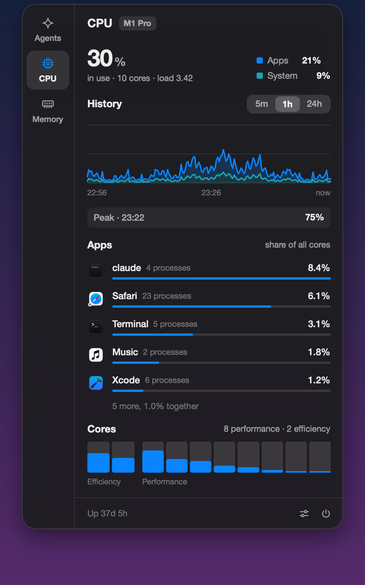
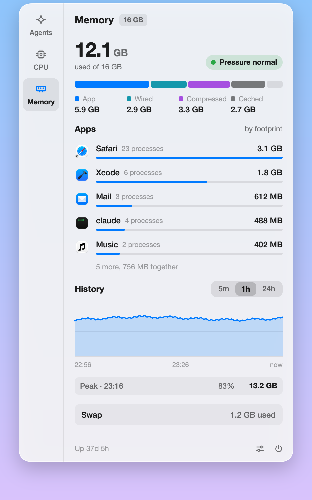

<p align="center">
  
</p>

<h1 align="center">Nerda Bar</h1>

<p align="center">
  <strong>Your AI plan's limits, and what your Mac is doing, in the menu bar.</strong><br>
  How much of your plan is left, the CPU and memory in use, and the apps behind them. Click for the whole picture.
</p>

<p align="center">
  <a href="https://github.com/kamafozilov/nerda.bar/releases/latest"></a>
  
  
  <a href="LICENSE"></a>
</p>

<p align="center">
  <a href="https://github.com/kamafozilov/nerda.bar/releases/latest/download/NerdaBar.dmg"><strong>Download for macOS</strong></a>
  &nbsp;·&nbsp;
  <a href="#what-it-shows">What it shows</a>
  &nbsp;·&nbsp;
  <a href="#where-the-numbers-come-from">Where the numbers come from</a>
  &nbsp;·&nbsp;
  <a href="#build-it-yourself">Build it yourself</a>
</p>

<br>

<table>
  <tr>
    <td width="50%"></td>
    <td width="50%"></td>
  </tr>
</table>

<br>

Nerda Bar shows how much of your Claude plan is left and what you used, and what your Mac is doing while you work: the CPU and memory in use, their history, and which apps take them, each app with all its processes together. It is a native app written in Rust with [Rune](https://github.com/anomalyco/rune), a **small download** with no account and no telemetry. Claude is the first provider; the others get their own menu bar item as they are added.

<table>
  <tr>
    <td width="33%" valign="top"><b>🎯 Exact</b><br>Limits are the numbers Anthropic reports. Tokens are counted from Claude Code's own logs, each message once. CPU and memory are read as Activity Monitor reads them.</td>
    <td width="33%" valign="top"><b>🪶 Light</b><br>About 35 MB of memory. With the panel closed: one request every 5 minutes, and a few system calls every 2 seconds for each measure in the menu bar.</td>
    <td width="33%" valign="top"><b>🔒 Private</b><br>Your login is only ever read, never renewed or rewritten. Nothing about you leaves your Mac.</td>
  </tr>
</table>

## Install

1. Download [NerdaBar.dmg](https://github.com/kamafozilov/nerda.bar/releases/latest/download/NerdaBar.dmg), open it and drag Nerda Bar onto Applications.
2. Open it from Applications. The first time, macOS says it can't check the app: open System Settings › Privacy & Security, scroll down and click **Open Anyway**. This is asked once.
3. Sign in to [Claude Code](https://claude.com/claude-code) if you haven't: Nerda Bar reads that login. The Claude mark and a percentage appear in the menu bar.
4. To keep the CPU or memory in the menu bar too, open the panel's settings and pick how each shows.

**Launch at Login** is in the panel's settings. Every release is signed with the same certificate, so macOS treats an update as the same app.

## What it shows

The panel has a tab for each thing it reads, in a rail down its left side: **Agents** for your AI plan, **CPU** and **Memory** for this Mac. A click on a menu bar item opens the panel on its own tab.

### Agents

<table>
  <tr>
    <td width="50%"><br><b>Running low</b>: orange at 30% left, red at 10%, and when the pace so far uses a limit up before it resets, the row says when.</td>
    <td width="50%"><br><b>Usage</b> for today by the hour, and for 7 and 30 days by the day.</td>
  </tr>
</table>

**In the menu bar**, the provider's mark and a percentage: the session limit, or whichever plan-wide limit is used up and so is what blocks work. A limit on one model alone, such as Fable's weekly limit, shows beside it, each with its letter: `W 23%  F 11%`. The number turns orange at 30% left and red at 10%, and dims when it could not be refreshed.

**In the panel**, opened with a click:

- At the top, one limit's history: how it fell from 100% day by day to what is left now, an even pace to compare against, and where the pace so far leads, with a ring where it runs out or resets. Over the chart, the limit's name and what is left, what was used today and whether the pace lasts until the reset; under the pointer, what was left then and what was used that day. A week's window reads by the day, the session's by the hour.
- Under it, every limit the plan has (session, weekly, per-model weekly, extra usage) with a meter, the time to its reset, and a tick where an even pace would be. Click a limit to show it in the chart; the one shown sits on a card, and the panel starts on the weekly limit with the least left.
- Usage for today, 7 days and 30 days: tokens, what they would have cost at API prices, a chart and a row per model. The totals read the bar under the pointer while it is on the chart, and hold the split into input, output and cache in their tooltip. The panel's foot has Refresh, Settings and Quit; the settings (what the menu bar shows, model limits, left or used, how the CPU and memory show, Launch at Login) open in the panel. A secondary click on the menu bar item has the same as a menu.

### This Mac

<table>
  <tr>
    <td width="50%"><br><b>CPU</b>: the share in use, its history, the apps using it now and each core.</td>
    <td width="50%"><br><b>Memory</b>: what is used and what kind, how hard macOS is working to find more, and the apps holding it.</td>
  </tr>
</table>

**CPU**: the share in use, split into apps and the system, and the load average. A chart of the last 5 minutes, hour or day, with a readout of the peak or of the moment under the pointer; the apps using the most CPU now; and a bar per core, efficiency and performance cores apart.

**Memory**: what is used out of the Mac's memory, split as Activity Monitor splits it (app, wired, compressed, cached), and memory pressure: normal, high or critical. Then the apps holding the most memory, the same history chart, and the swap in use.

**Apps** are whole apps, not processes: a browser's dozens of helpers and renderers add up to one row with its icon, saying how many processes it runs. A command line tool such as `claude` has a row of its own. Five show, and a line under them sums the rest.

**In the menu bar**, the CPU and memory each get an item of their own once the settings put them there, in one of three styles: a ring filled to the share, a graph of the last half minute, or the name and number as text (`CPU 18%`). Memory turns orange when its pressure is high and red when it is critical. ⌘-drag an item to move it; macOS keeps its place.

### Keys

| Key | Action |
| --- | --- |
| ⌘1, ⌘2, ⌘3 | Agents, CPU, Memory |
| ⌘R | Refresh the limits now |
| ⌘, | Settings |
| esc | Back from Settings, else close the panel |
| ⌘Q | Quit |

## Where the numbers come from

- **Limits** are what Anthropic reports for your login (`api.anthropic.com/api/oauth/usage`), the same numbers as Claude Code's `/usage`. They refresh every 5 minutes and when the panel opens, never more often than once a minute: the endpoint allows about 30 requests an hour, shared with Claude Code.
- **The login** is Claude Code's, read from the Keychain item it keeps (or `~/.claude/.credentials.json`). It is only ever read. Nerda Bar never renews or rewrites it, because renewing it behind Claude Code's back can sign the CLI out; when the login has expired the panel says so, and running `claude` once renews it.
- **The limit chart** draws what each refresh read, kept for 8 days in `history.json`. Where there are no readings (before Nerda Bar's first run, or while the Mac slept), what the limit gained across the gap is spread over its hours by what this Mac's messages to the models it counts would have cost at API prices, and drawn paler as an estimate. Use on another device shows up in the readings but not in this Mac's logs: across a gap with no activity here, the chart draws a straight line.
- **Usage** is counted from Claude Code's own session logs under `~/.claude/projects`. Each message counts once, however many times the logs repeat it, by your local calendar day. Only what the logs gained since the last read is read again.
- **Prices** are the API prices from [models.dev](https://models.dev), fetched once a day and kept in `prices.json`. A model without a listed price shows `—` and the total a `+`. Fast mode's premium is not priced.
- **CPU and memory** come from macOS itself, as Activity Monitor reads them: each core's ticks (`host_processor_info`), the memory's page counts (`host_statistics64`), memory pressure and swap (`sysctl`). None of it needs a password. They are read every second while the panel shows them, every 2 seconds while the menu bar does, every 20 seconds while only the panel's history needs them, and not at all with both tabs and both items off. The history is kept in memory, so it starts again when Nerda Bar does.
- **Apps** are read only while the panel shows the CPU or Memory tab: each process's footprint (the memory figure Activity Monitor shows) and CPU time, summed by the outermost app bundle it runs from, or by the app macOS holds responsible for it. Processes of other users and of the system itself, such as WindowServer, can't be read without an administrator's password, so they are left out.

None of it leaves your Mac, and nothing else does.

## Settings

The panel's settings cover all but the last two of these. Everything lives in `~/Library/Application Support/nerda.bar/config.json`, read at launch:

```json
{
  "menu_bar": "session",
  "menu_bar_models": true,
  "show_used": false,
  "cpu": { "menu_bar": "off", "tab": true },
  "memory": { "menu_bar": "off", "tab": true },
  "refresh_minutes": 5,
  "material": "popover"
}
```

`menu_bar` is `session`, `weekly` or `lowest` (the plan-wide limit with the least left). `menu_bar_models` adds each model's own limit beside it. `cpu` and `memory` each say how their menu bar item shows, `off`, `text`, `ring` or `graph`, and whether the panel has their tab; with neither tab, the panel has no rail and is the Agents tab alone. `refresh_minutes` is at least 5. `material` is `popover` (frosted vibrancy) or `glass` (Liquid Glass on macOS 26 and later).

## Build it yourself

You need a Mac with Apple silicon, Xcode's command line tools and [Rust](https://rustup.rs).

```sh
scripts/bundle.sh --install     # builds, signs, installs /Applications/Nerda Bar.app and starts it
scripts/release.sh              # packs dist/NerdaBar.dmg
scripts/release.sh --publish    # also tags the commit and publishes it as a GitHub release
cargo run --release             # or run the bare binary
cargo test
```

`scripts/bundle.sh` signs with a self-signed certificate, "Nerda Bar Local Signing", which it makes in your login keychain the first time, so every build is the same app to macOS. Set `SIGN_IDENTITY` to sign with a certificate of your own.

To release a new version: raise `version` in `Cargo.toml`, commit, and run `scripts/release.sh --publish`. It runs the tests, checks the build is signed with the release certificate, and uploads the disk image as the latest release, which is what the download link above points at.

### Checking the UI without a window

Rune renders headlessly with sample data; nothing is read from your login or your logs:

```sh
target/release/nerda-bar --snap panel.png --theme dark
target/release/nerda-bar --snap low.png --scene low --theme light
target/release/nerda-bar --snap cpu.png --scene cpu --theme dark
target/release/nerda-bar --list-scenes
```

`NERDA_BAR_DEBUG=1` prints what the worker thread sees and the rate this Mac's measures are read at, `NERDA_BAR_DIR=/some/dir` runs against another data folder, and `--show` opens the panel at launch.

### Layout

- `src/main.rs`: wiring and window options
- `src/ui.rs`: state, tabs, keys, open and close
- `src/view.rs`: the panel: its rail, the Agents tab, the settings
- `src/burn.rs`, `src/burn_view.rs`: each limit's history and the chart of its window
- `src/system_view.rs`: the CPU and Memory tabs
- `src/status_item.rs`: the menu bar items, their glyphs and their menu (AppKit)
- `src/worker.rs`: the background thread and its schedule
- `src/system/`: this Mac's measures: the thread that reads them (`mod.rs`), their history at three resolutions (`history.rs`), the apps behind them (`apps.rs`) and the system calls (`mac.rs`)
- `src/claude.rs`: the Claude provider: login and limits
- `src/stats.rs`: token counts from the session logs
- `src/prices.rs`: API prices
- `src/model.rs`, `src/time.rs`, `src/config.rs`, `src/demo.rs`: limits, the clock, settings, sample data
- `src/alloc.rs`: the allocator that returns large blocks to the system when freed

### Adding a provider

A provider is a module that returns a `model::Snapshot` (its plan and limits), a mark in `assets/providers/`, and a call to `status_item::install` with its id. `src/claude.rs` is the one to copy.

## Licence

[MIT](LICENSE). Provider names and marks belong to their owners and are used only to say which service a number is for.
