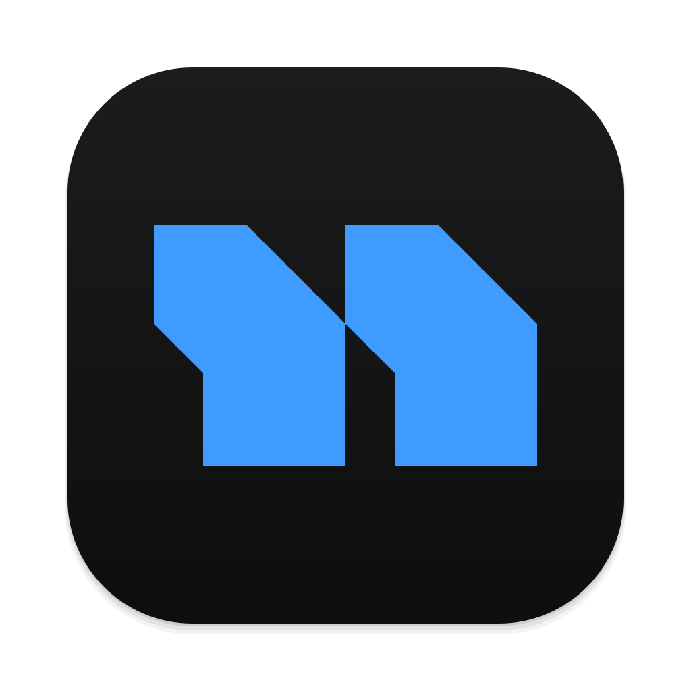
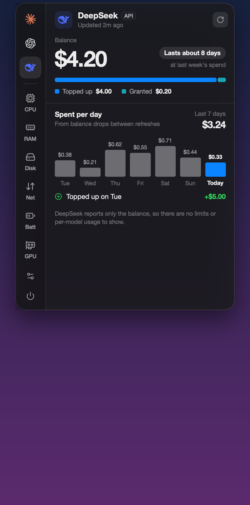
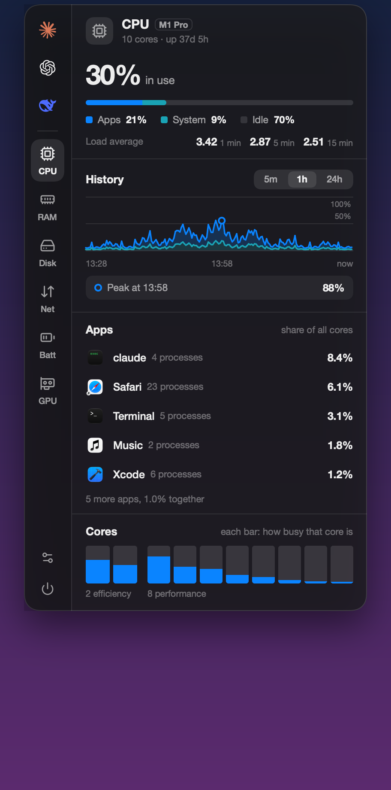
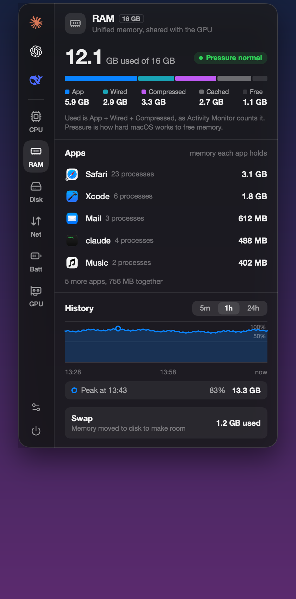
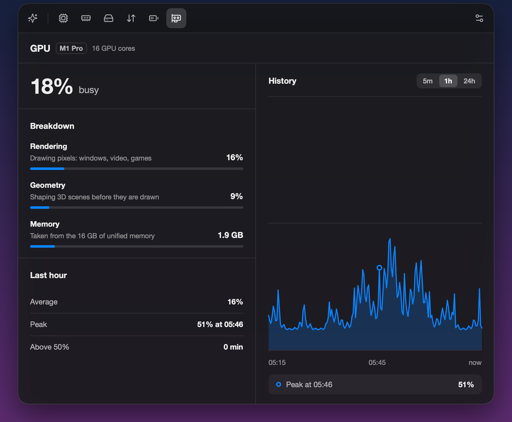

<p align="center">
  
</p>

<h1 align="center">Nerda Bar</h1>

<p align="center">
  <strong>Your AI plan's limits, and what your Mac is doing, in the menu bar.</strong><br>
  How much of your plan is left, the CPU and memory in use, and the apps behind them. Click for the whole picture.
</p>

<p align="center">
  <a href="https://github.com/kamafozilov/nerda.bar/releases/latest"></a>
  
  
  <a href="LICENSE"></a>
</p>

<p align="center">
  <a href="https://github.com/kamafozilov/nerda.bar/releases/latest/download/NerdaBar.dmg"><strong>Download for macOS</strong></a>
  &nbsp;·&nbsp;
  <a href="#what-it-shows">What it shows</a>
  &nbsp;·&nbsp;
  <a href="#where-the-numbers-come-from">Where the numbers come from</a>
  &nbsp;·&nbsp;
  <a href="#build-it-yourself">Build it yourself</a>
</p>

<br>

<table>
  <tr>
    <td width="50%"></td>
    <td width="50%"></td>
  </tr>
</table>

<br>

Nerda Bar shows how much of your AI plans is left and what you used (Claude, Codex and DeepSeek), and what your Mac is doing while you work: CPU, memory, disk, network, battery and GPU, their history, and which apps take them, each app with all its processes together. It is a native app written in Rust with [Rune](https://github.com/anomalyco/rune), a **small download** with no account and no telemetry.

<table>
  <tr>
    <td width="33%" valign="top"><b>🎯 Exact</b><br>Limits are the numbers each provider reports. Tokens are counted from Claude Code's and the Codex CLI's own logs, each message once. This Mac is read as Activity Monitor reads it.</td>
    <td width="33%" valign="top"><b>🪶 Light</b><br>About 46 MB of memory. With the panel closed: one request every 5 minutes per signed-in provider, and a few system calls every 20 seconds for this Mac's history, every 2 seconds for each measure in the menu bar.</td>
    <td width="33%" valign="top"><b>🔒 Private</b><br>Your logins are only ever read, never renewed or rewritten. Nothing about you leaves your Mac but each provider's request to its own service.</td>
  </tr>
</table>

## Install

1. Download [NerdaBar.dmg](https://github.com/kamafozilov/nerda.bar/releases/latest/download/NerdaBar.dmg), open it and drag Nerda Bar onto Applications.
2. Open it from Applications. The first time, macOS says it can't check the app: open System Settings › Privacy & Security, scroll down and click **Open Anyway**. This is asked once.
3. Sign in to [Claude Code](https://claude.com/claude-code) if you haven't: Nerda Bar reads that login. The Claude mark and a percentage appear in the menu bar.
4. To keep the CPU or memory in the menu bar too, open the panel's settings and pick how each shows.

**Launch at Login** is in the panel's settings. Every release is signed with the same certificate, so macOS treats an update as the same app.

## What it shows

The panel has a rail down its left side: the providers by their marks (Claude, Codex, DeepSeek), then this Mac's measures (CPU, RAM, Disk, Net, Batt, GPU), and at its foot Settings and Quit. A click on a menu bar item opens the panel on its own tab.

### Claude and Codex

<table>
  <tr>
    <td width="50%"><br><b>Running low</b>: orange at 30% left, red at 10%, and when the pace so far uses a limit up before it resets, the row and the chart's pill say when.</td>
    <td width="50%"><br><b>Codex</b>: the 5-hour and weekly limits, and the free resets the plan has been given, each spent only after you confirm it.</td>
  </tr>
</table>

- **Limits**: a ring per limit (session or 5-hour, weekly, per-model weekly) filled to what is left, with a tick where an even pace would be, the time to its reset, and extra usage with its cap. Hover a ring for how far ahead or behind an even pace you are; click it to chart it.
- **The chart**: the picked limit's window from 100% down to now, an even pace to compare against, where the pace so far leads, and a pill saying whether it lasts until the reset. Under the pointer, what was left then and what was used that day.
- **Usage** for today by the hour, and for 7 and 30 days by the day: tokens, what they would have cost at API prices, a chart split by model, and a row per model. The bar under the pointer replaces the totals; hovering the totals splits them into input, output and cache.
- **Problems** show as a banner over the numbers they make stale (offline, login expired, updates paused, a failed request), and the numbers fade until they are current again. Without a login, the tab says what to run, with a Copy button.

Claude's limit resets ("Reset for free") can only be used in Claude's own apps, so the panel doesn't offer them.

### DeepSeek



DeepSeek reports only the account's balance. The tab shows it split into topped-up and granted credit, how long it lasts at last week's spend, and the spend per day, read from how the balance fell between refreshes; a rise is a top-up.

The key is read from the Keychain. Add it once in a terminal (it asks for the key, so it never lands in your shell history):

```sh
security add-generic-password -s "Nerda Bar" -a deepseek -w
```

`DEEPSEEK_API_KEY` works too when Nerda Bar is started from a shell.

<br clear="right">

### This Mac

<table>
  <tr>
    <td width="33%"><br><b>CPU</b>: the share in use split into apps and the system, the load average, its history, the apps using it and each core.</td>
    <td width="33%"><br><b>RAM</b>: used memory by kind (app, wired, compressed, cached, free), pressure, the apps holding it, its history and swap.</td>
    <td width="33%"><br><b>Disk</b>: used, purgeable and free space, read and write rates, the apps that read and wrote the most in the last hour, and other volumes with Eject.</td>
  </tr>
  <tr>
    <td width="33%"><br><b>Network</b>: download and upload now, their history with download over the line and upload under it, what moved since midnight, and each interface.</td>
    <td width="33%"><br><b>Battery</b>: the charge and the time left at this draw, the last day or week of charge with plugged-in stretches shaded, and its health.</td>
    <td width="33%"><br><b>GPU</b>: how busy it is, its rendering and geometry stages, the memory it holds, and its history.</td>
  </tr>
</table>

**Apps** are whole apps, not processes: a browser's dozens of helpers and renderers add up to one row with its icon, saying how many processes it runs. A command line tool such as `claude` has a row of its own.

**In the menu bar**, each measure can have an item of its own, in one of three styles: a ring filled to the share, a graph of the last half minute, or the name and number as text (`CPU 18%`, `NET ↓2.4 MB/s ↑380 KB/s`). ⌘-drag an item to move it; macOS keeps its place.

### The menu bar

Each provider has an item with its mark. Claude's shows the limit the settings pick and, with model limits on, each model's own limit beside it by name: `Weekly 59%  Fable 42%`, or on a plan with a session `Session 24%  Fable 42%`. Codex shows its 5-hour or weekly limit, and DeepSeek its balance. Numbers turn orange at 30% left and red at 10%, and dim when they could not be refreshed. Codex and DeepSeek add their items once they are signed in.

### Keys

| Key | Action |
| --- | --- |
| ⌘1 … ⌘9 | The rail's tabs in order |
| ⌘R | Refresh the shown provider now |
| ⌘, | Settings |
| esc | Back from Settings, else close the panel |
| ⌘Q | Quit |

## Where the numbers come from

- **Claude's limits** are what Anthropic reports for your login (`api.anthropic.com/api/oauth/usage`), the same numbers as Claude Code's `/usage`. The login is Claude Code's, read from its Keychain item (or `~/.claude/.credentials.json`) and never renewed or rewritten: renewing it behind Claude Code's back can sign the CLI out. Running `claude` once renews an expired one.
- **Codex's limits** are what ChatGPT reports for the Codex CLI's login (`chatgpt.com/backend-api/wham/usage`), read from `~/.codex/auth.json` (or its Keychain item) and never renewed. Free resets are listed from the same service; one is spent only when you confirm it in the panel.
- **DeepSeek's balance** is `api.deepseek.com/user/balance`, with your key.
- Limits refresh every 5 minutes and when the panel opens, never more often than once a minute.
- **The limit chart** draws what each refresh read, kept for 8 days (`history.json`, `codex-history.json`). Where there are no readings, what the limit gained is spread over its hours by this Mac's activity and drawn paler as an estimate.
- **Usage** is counted from the session logs: Claude Code's under `~/.claude/projects`, each message once; the Codex CLI's under `~/.codex/sessions`, each response once. **Prices** are the API prices from [models.dev](https://models.dev), fetched once a day.
- **This Mac** is read from macOS itself, as Activity Monitor reads it: CPU ticks and memory pages from the kernel, disk and GPU statistics and the battery from IOKit, volumes from the file system, traffic from each interface's counters and its name from the network settings. None of it needs a password. Measures are read every second while the panel shows them, every 2 seconds while the menu bar does, every 20 seconds while only the history needs them, and not at all with every tab and item off. The battery's charge is kept for a week in `battery.json`; the rest of the history is kept in memory.

None of it leaves your Mac, except each provider's own request to its own service.

## Settings

The panel's settings cover all but the last two of these. Everything lives in `~/Library/Application Support/nerda.bar/config.json`, read at launch:

```json
{
  "menu_bar": "session",
  "menu_bar_models": true,
  "show_used": false,
  "codex": { "menu_bar": "session", "show_used": false },
  "deepseek_menu_bar": true,
  "cpu": { "menu_bar": "off", "tab": true },
  "memory": { "menu_bar": "off", "tab": true },
  "disk": { "menu_bar": "off", "tab": true },
  "network": { "menu_bar": "off", "tab": true },
  "battery": { "menu_bar": "off", "tab": true },
  "gpu": { "menu_bar": "off", "tab": true },
  "refresh_minutes": 5,
  "material": "popover"
}
```

`menu_bar` is `session`, `weekly` or `lowest` (the plan-wide limit with the least left); a plan without a session limit shows the weekly one. `menu_bar_models` adds each model's own limit beside it. Each measure says how its menu bar item shows, `off`, `text`, `ring` or `graph`, and whether the panel has its tab. `refresh_minutes` is at least 5. `material` is `popover` (frosted vibrancy) or `glass` (Liquid Glass on macOS 26 and later).

## Build it yourself

You need a Mac with Apple silicon, Xcode's command line tools and [Rust](https://rustup.rs).

```sh
scripts/bundle.sh --install     # builds, signs, installs /Applications/Nerda Bar.app and starts it
scripts/release.sh              # packs dist/NerdaBar.dmg
scripts/release.sh --publish    # also tags the commit and publishes it as a GitHub release
cargo run --release             # or run the bare binary
cargo test
```

`scripts/bundle.sh` signs with a self-signed certificate, "Nerda Bar Local Signing", which it makes in your login keychain the first time, so every build is the same app to macOS. Set `SIGN_IDENTITY` to sign with a certificate of your own.

To release a new version: raise `version` in `Cargo.toml`, commit, and run `scripts/release.sh --publish`. It runs the tests, checks the build is signed with the release certificate, and uploads the disk image as the latest release, which is what the download link above points at.

### Checking the UI without a window

Rune renders headlessly with sample data; nothing is read from your login or your logs:

```sh
target/release/nerda-bar --snap panel.png --theme dark
target/release/nerda-bar --snap low.png --scene low --theme light
target/release/nerda-bar --snap cpu.png --scene cpu --theme dark
target/release/nerda-bar --snap codex.png --scene codex-confirm
target/release/nerda-bar --list-scenes
```

`NERDA_BAR_DEBUG=1` prints what the worker thread sees and the rate this Mac's measures are read at, `NERDA_BAR_DIR=/some/dir` runs against another data folder, and `--show` opens the panel at launch.

### Layout

- `src/main.rs`: wiring, window options and the headless scenes
- `src/ui.rs`: state, tabs, keys, open and close
- `src/agents.rs`: each provider's state, the worker's events, the providers' menu bar items, the reset flow
- `src/view.rs`: the panel and its rail; `src/look.rs`: colours, type and shared pieces
- `src/agents_view.rs`, `src/burn_view.rs`, `src/resets_view.rs`: Claude's and Codex's tabs, the limit chart, free resets
- `src/deepseek_view.rs`: DeepSeek's tab
- `src/system_view.rs`, `src/mac_view.rs`: this Mac's tabs
- `src/settings_view.rs`: the settings
- `src/status_item.rs`: the menu bar items, their glyphs and their menu (AppKit)
- `src/worker.rs`: the background thread and each provider's schedule
- `src/system/`: this Mac's measures: the thread that reads them (`mod.rs`, `more.rs`), their history (`history.rs`), the apps behind them (`apps.rs`), and the readers (`mac.rs`, `disk.rs`, `net.rs`, `battery.rs`, `gpu.rs`, `iokit.rs`)
- `src/claude.rs`, `src/codex.rs`, `src/deepseek.rs`: the providers
- `src/stats.rs`, `src/codex_logs.rs`: token counts from the session logs
- `src/prices.rs`: API prices
- `src/model.rs`, `src/time.rs`, `src/config.rs`, `src/demo.rs`, `src/icons.rs`: limits, the clock, settings, sample data, icons
- `src/alloc.rs`: the allocator that returns large blocks to the system when freed

### Adding a provider

A provider is a module that returns a `model::Snapshot` (its plan and limits), a `Provider` variant, a mark in `assets/providers/` and `src/icons.rs`, and a job in `src/worker.rs`. `src/codex.rs` is the one to copy.

## Licence

[MIT](LICENSE). Provider names and marks belong to their owners and are used only to say which service a number is for.
