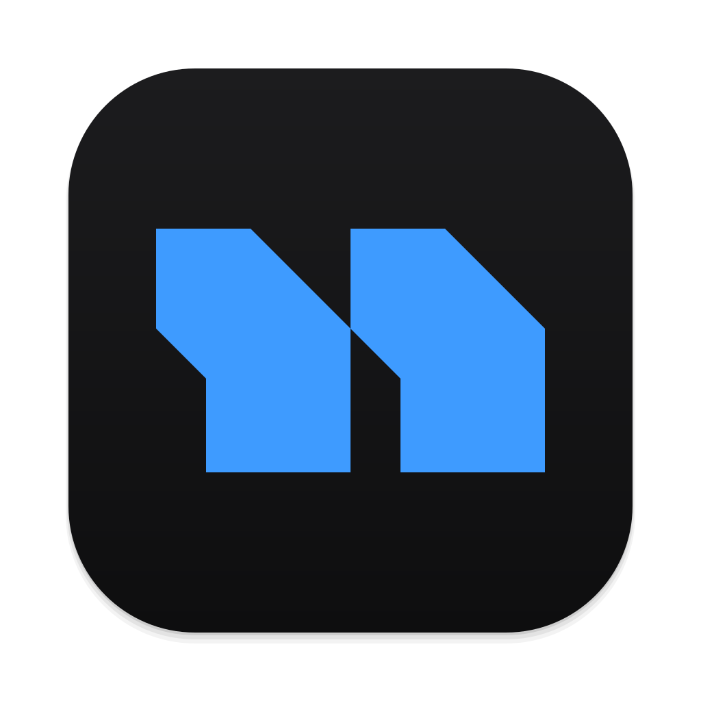
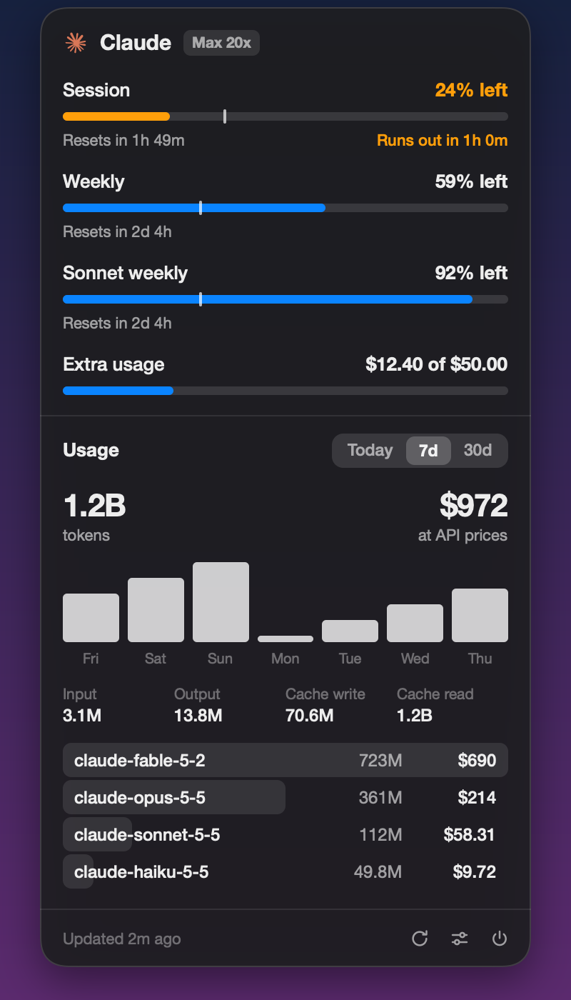
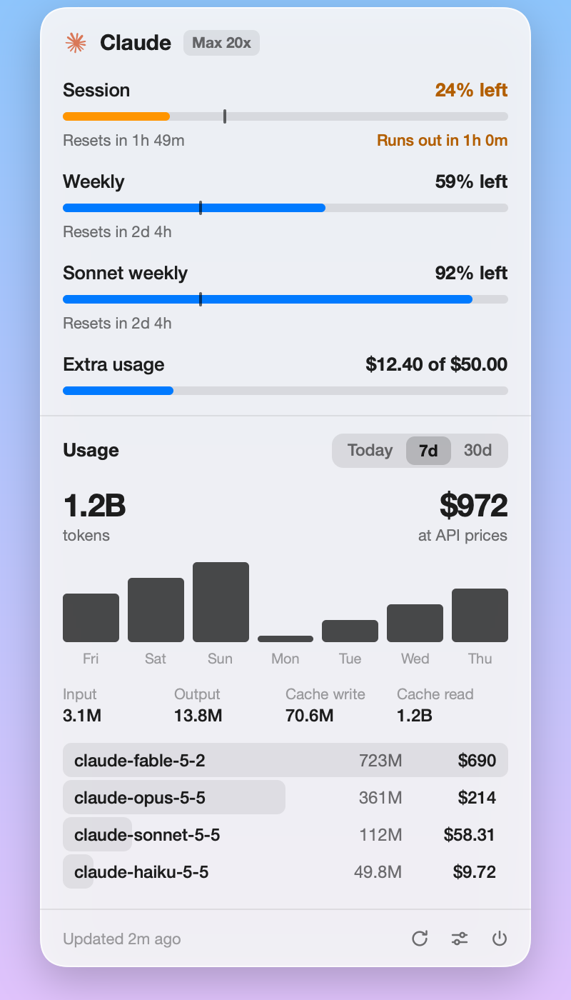
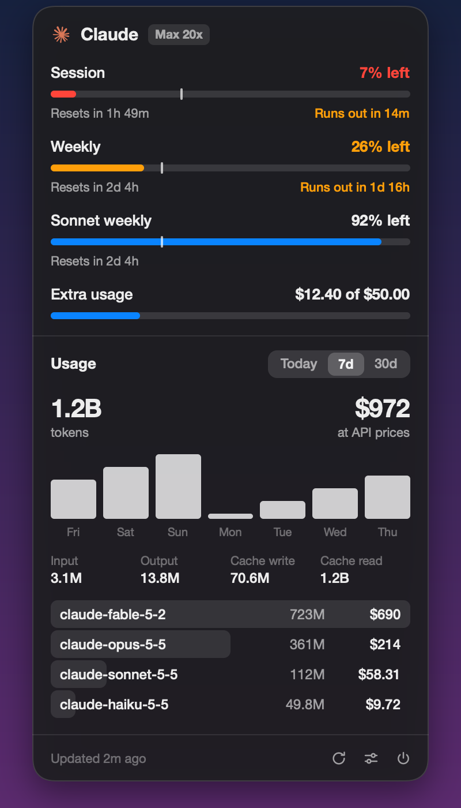
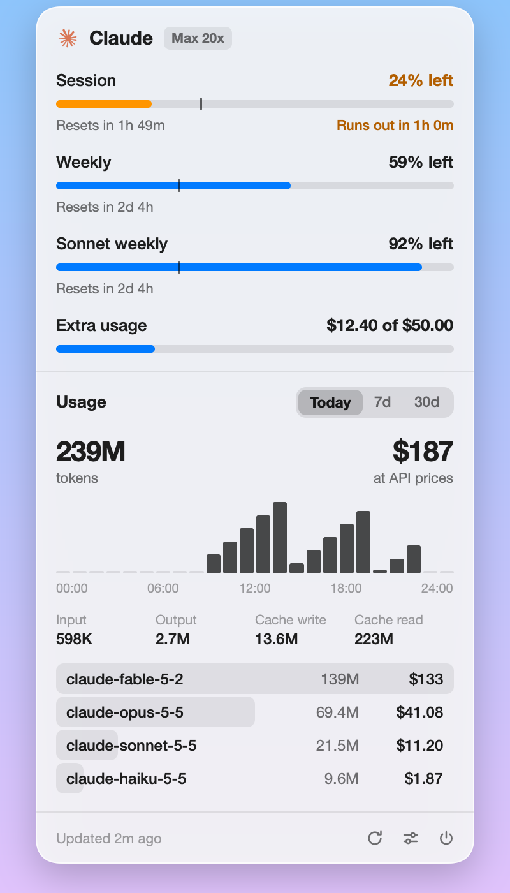

<p align="center">
  
</p>

<h1 align="center">Nerda Bar</h1>

<p align="center">
  <strong>Your AI plan's limits in the Mac menu bar.</strong><br>
  One item per provider, with its mark and how much is left. Click it for every limit and what you used.
</p>

<p align="center">
  <a href="https://github.com/kamafozilov/nerda.bar/releases/latest"></a>
  
  
  <a href="LICENSE"></a>
</p>

<p align="center">
  <a href="https://github.com/kamafozilov/nerda.bar/releases/latest/download/NerdaBar.dmg"><strong>Download for macOS</strong></a>
  &nbsp;·&nbsp;
  <a href="#what-it-shows">What it shows</a>
  &nbsp;·&nbsp;
  <a href="#where-the-numbers-come-from">Where the numbers come from</a>
  &nbsp;·&nbsp;
  <a href="#build-it-yourself">Build it yourself</a>
</p>

<br>

<table>
  <tr>
    <td width="50%"></td>
    <td width="50%"></td>
  </tr>
</table>

<br>

Nerda Bar shows how much of your Claude plan is left, and what you used, without opening anything. It is a native app written in Rust with [Rune](https://github.com/anomalyco/rune), a **small download** with no account and no telemetry. Claude is the first provider; the others get their own menu bar item as they are added.

<table>
  <tr>
    <td width="33%" valign="top"><b>🎯 Exact</b><br>Limits are the numbers Anthropic reports. Tokens are counted from Claude Code's own logs, each message once.</td>
    <td width="33%" valign="top"><b>🪶 Light</b><br>About 45 MB of memory and no work while the panel is closed, beyond one request every 5 minutes.</td>
    <td width="33%" valign="top"><b>🔒 Private</b><br>Your login is only ever read, never renewed or rewritten. Nothing about you leaves your Mac.</td>
  </tr>
</table>

## Install

1. Download [NerdaBar.dmg](https://github.com/kamafozilov/nerda.bar/releases/latest/download/NerdaBar.dmg), open it and drag Nerda Bar onto Applications.
2. Open it from Applications. The first time, macOS says it can't check the app: open System Settings › Privacy & Security, scroll down and click **Open Anyway**. This is asked once.
3. Sign in to [Claude Code](https://claude.com/claude-code) if you haven't: Nerda Bar reads that login. The Claude mark and a percentage appear in the menu bar.

**Launch at Login** is in the panel's settings. Every release is signed with the same certificate, so macOS treats an update as the same app.

## What it shows

<table>
  <tr>
    <td width="50%"><br><b>Running low</b>: orange at 30% left, red at 10%, and when the pace so far uses a limit up before it resets, the row says when.</td>
    <td width="50%"><br><b>Usage</b> for today by the hour, and for 7 and 30 days by the day.</td>
  </tr>
</table>

**In the menu bar**, the provider's mark and a percentage: the session limit, or whichever plan-wide limit is used up and so is what blocks work. The number turns orange at 30% left and red at 10%, and dims when it could not be refreshed.

**In the panel**, opened with a click:

- Every limit the plan has (session, weekly, per-model weekly, extra usage) with a meter, the time to its reset, and a tick where an even pace would be.
- Usage for today, 7 days and 30 days: tokens, what they would have cost at API prices, a chart, the split into input, output and cache, and a row per model.

Move the pointer over the chart and the figures above it read for that hour or day. Click a limit to switch every percentage between left and used. The panel's foot has Refresh, Settings and Quit; the settings (what the menu bar shows, left or used, Launch at Login) open in the panel. A secondary click on the menu bar item has the same as a menu.

| Key | Action |
| --- | --- |
| ⌘R | Refresh now |
| ⌘, | Settings |
| esc | Close the panel |
| ⌘Q | Quit |

## Where the numbers come from

- **Limits** are what Anthropic reports for your login (`api.anthropic.com/api/oauth/usage`), the same numbers as Claude Code's `/usage`. They refresh every 5 minutes and when the panel opens, never more often than once a minute: the endpoint allows about 30 requests an hour, shared with Claude Code.
- **The login** is Claude Code's, read from the Keychain item it keeps (or `~/.claude/.credentials.json`). It is only ever read. Nerda Bar never renews or rewrites it, because renewing it behind Claude Code's back can sign the CLI out; when the login has expired the panel says so, and running `claude` once renews it.
- **Usage** is counted from Claude Code's own session logs under `~/.claude/projects`. Each message counts once, however many times the logs repeat it, by your local calendar day. Only what the logs gained since the last read is read again.
- **Prices** are the API prices from [models.dev](https://models.dev), fetched once a day and kept in `prices.json`. A model without a listed price shows `—` and the total a `+`. Fast mode's premium is not priced.

Nothing else leaves your Mac.

## Settings

The panel's settings cover the first two of these. The rest live in `~/Library/Application Support/nerda.bar/config.json`, read at launch:

```json
{
  "menu_bar": "session",
  "show_used": false,
  "refresh_minutes": 5,
  "material": "popover"
}
```

`menu_bar` is `session`, `weekly` or `lowest` (the plan-wide limit with the least left). `refresh_minutes` is at least 5. `material` is `popover` (frosted vibrancy) or `glass` (Liquid Glass on macOS 26 and later).

## Build it yourself

You need a Mac with Apple silicon, Xcode's command line tools and [Rust](https://rustup.rs).

```sh
scripts/bundle.sh --install     # builds, signs, installs /Applications/Nerda Bar.app and starts it
scripts/release.sh              # packs dist/NerdaBar.dmg
scripts/release.sh --publish    # also tags the commit and publishes it as a GitHub release
cargo run --release             # or run the bare binary
cargo test
```

`scripts/bundle.sh` signs with a self-signed certificate, "Nerda Bar Local Signing", which it makes in your login keychain the first time, so every build is the same app to macOS. Set `SIGN_IDENTITY` to sign with a certificate of your own.

To release a new version: raise `version` in `Cargo.toml`, commit, and run `scripts/release.sh --publish`. It runs the tests, checks the build is signed with the release certificate, and uploads the disk image as the latest release, which is what the download link above points at.

### Checking the UI without a window

Rune renders headlessly with sample data; nothing is read from your login or your logs:

```sh
target/release/nerda-bar --snap panel.png --theme dark
target/release/nerda-bar --snap low.png --scene low --theme light
target/release/nerda-bar --list-scenes
```

`NERDA_BAR_DEBUG=1` prints what the worker thread sees, `NERDA_BAR_DIR=/some/dir` runs against another data folder, and `--show` opens the panel at launch.

### Layout

- `src/main.rs`: wiring and window options
- `src/ui.rs`: state, keys, open and close
- `src/view.rs`: the panel
- `src/status_item.rs`: the menu bar items and their menu (AppKit)
- `src/worker.rs`: the background thread and its schedule
- `src/claude.rs`: the Claude provider: login and limits
- `src/stats.rs`: token counts from the session logs
- `src/prices.rs`: API prices
- `src/model.rs`, `src/time.rs`, `src/config.rs`, `src/demo.rs`: limits, the clock, settings, sample data
- `src/alloc.rs`: the allocator that returns large blocks to the system when freed

### Adding a provider

A provider is a module that returns a `model::Snapshot` (its plan and limits), a mark in `assets/providers/`, and a call to `status_item::install` with its id. `src/claude.rs` is the one to copy.

## Licence

[MIT](LICENSE). Provider names and marks belong to their owners and are used only to say which service a number is for.
