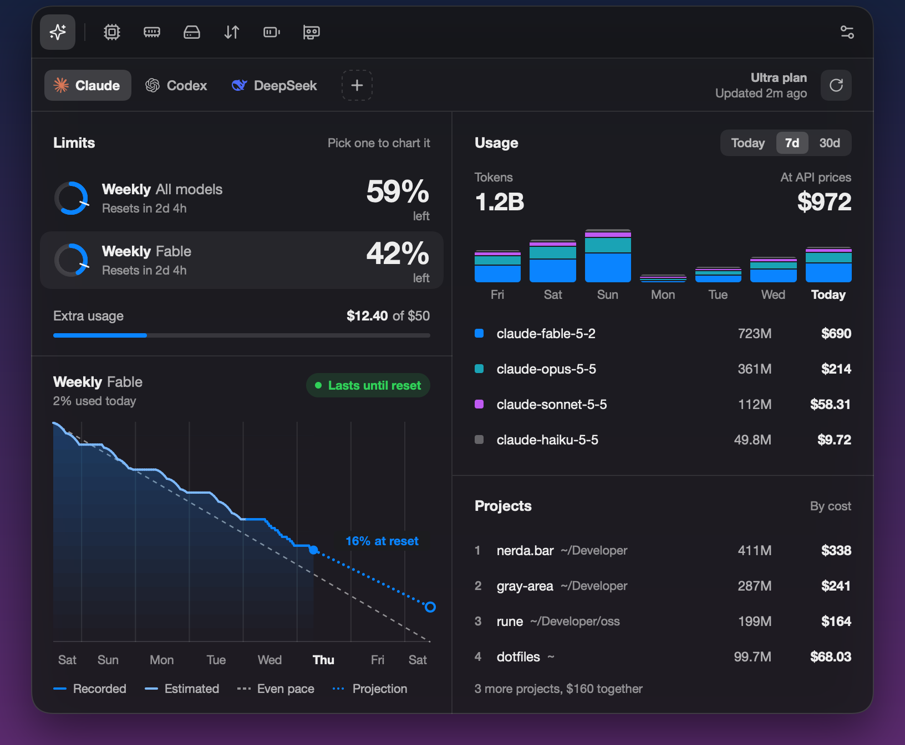
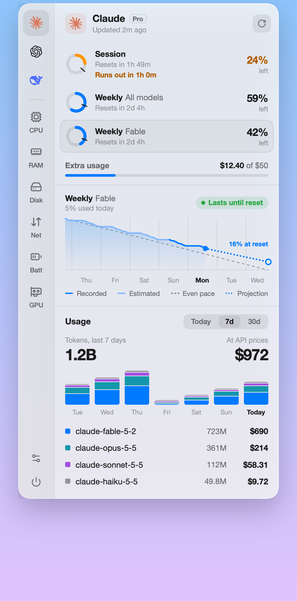
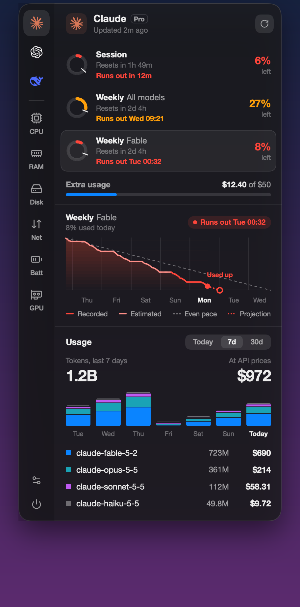
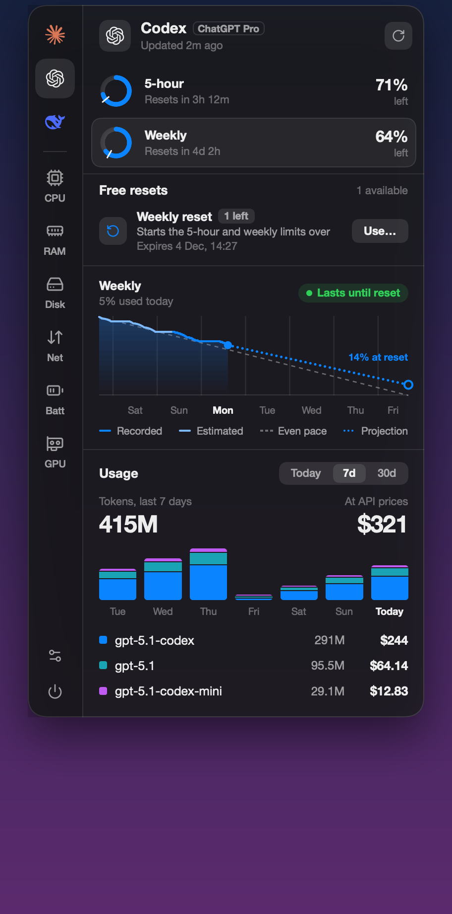
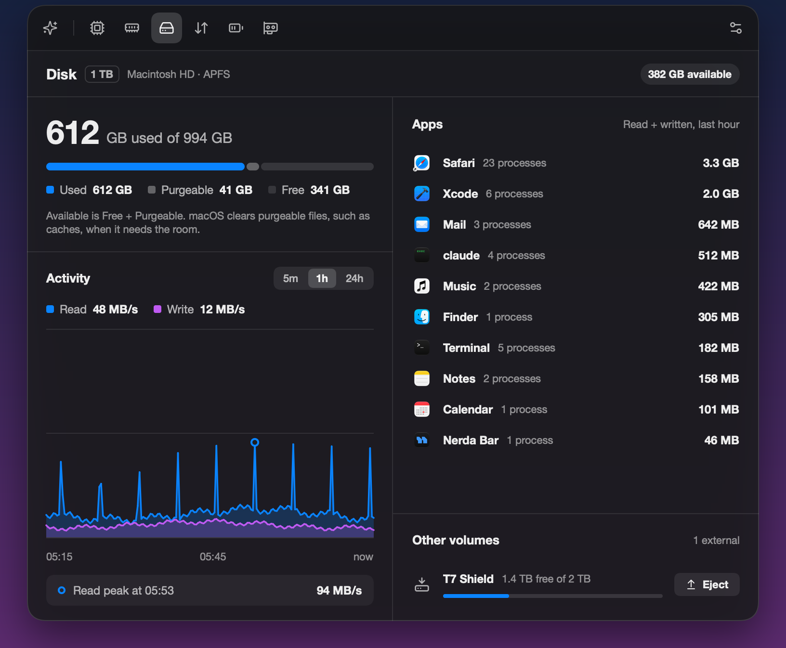
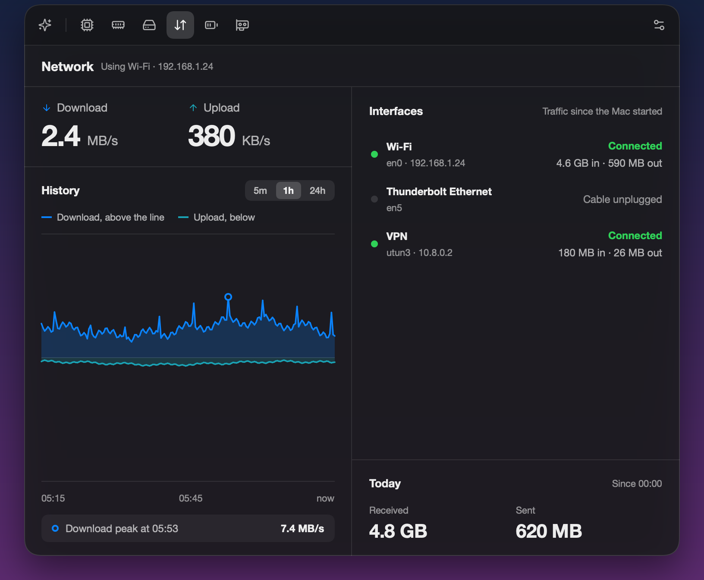
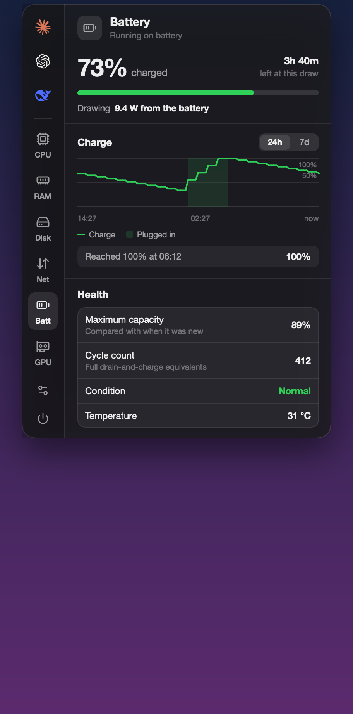
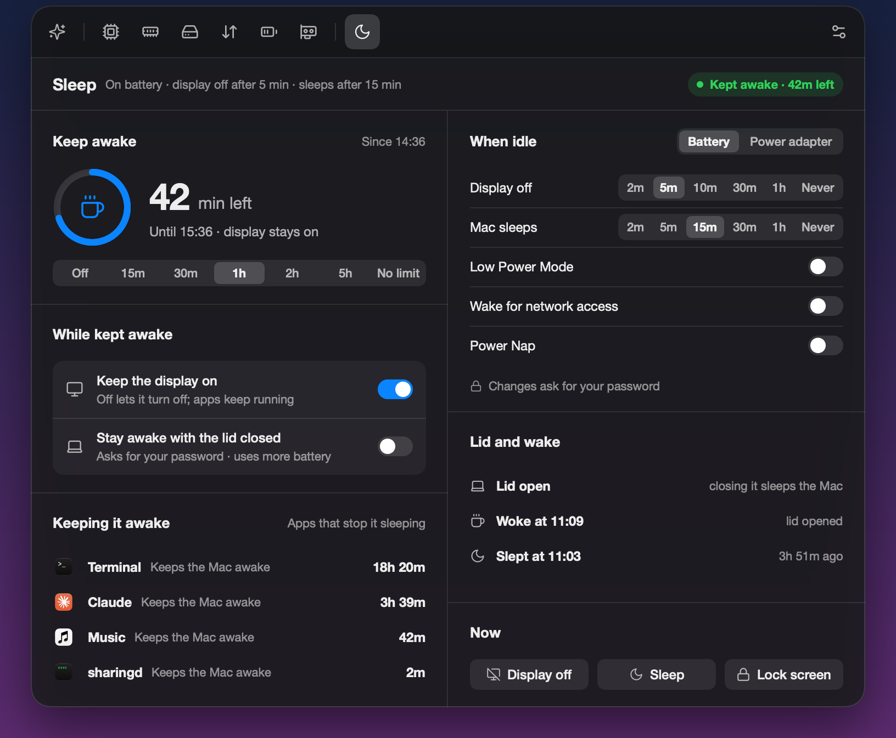

<p align="center">
  
</p>

<h1 align="center">Nerda Bar</h1>

<p align="center">
  <strong>Your AI plan's limits, and what your Mac is doing, in the menu bar.</strong><br>
  How much of your plan is left, the CPU and memory in use, and the apps behind them. Click for the whole picture.
</p>

<p align="center">
  <a href="https://github.com/kamafozilov/nerda.bar/releases/latest"></a>
  
  
  <a href="LICENSE"></a>
</p>

<p align="center">
  <a href="https://github.com/kamafozilov/nerda.bar/releases/latest/download/NerdaBar.dmg"><strong>Download for macOS</strong></a>
  &nbsp;·&nbsp;
  <a href="#what-it-shows">What it shows</a>
  &nbsp;·&nbsp;
  <a href="#where-the-numbers-come-from">Where the numbers come from</a>
  &nbsp;·&nbsp;
  <a href="#build-it-yourself">Build it yourself</a>
</p>

<br>

<table>
  <tr>
    <td width="50%"></td>
    <td width="50%"></td>
  </tr>
</table>

<br>

Nerda Bar shows how much of your AI plans is left and what you used (Claude, Codex and DeepSeek), and what your Mac is doing while you work: CPU, memory, disk, network, battery and GPU, their history, and which apps take them, each app with all its processes together. It is a native app written in Rust with [Rune](https://github.com/anomalyco/rune), a **small download** with no account and no telemetry.

<table>
  <tr>
    <td width="33%" valign="top"><b>🎯 Exact</b><br>Limits are the numbers each provider reports. Tokens are counted from Claude Code's and the Codex CLI's own logs, each message once. This Mac is read as Activity Monitor reads it.</td>
    <td width="33%" valign="top"><b>🪶 Light</b><br>About 46 MB of memory. With the panel closed: one request every 5 minutes per signed-in provider, and a few system calls every 20 seconds for this Mac's history, every 2 seconds for each measure in the menu bar.</td>
    <td width="33%" valign="top"><b>🔒 Private</b><br>Your logins are only ever read, never renewed or rewritten. Nothing about you leaves your Mac but each provider's request to its own service.</td>
  </tr>
</table>

## Install

1. Download [NerdaBar.dmg](https://github.com/kamafozilov/nerda.bar/releases/latest/download/NerdaBar.dmg), open it and drag Nerda Bar onto Applications.
2. Open it from Applications. The first time, macOS says it can't check the app: open System Settings › Privacy & Security, scroll down and click **Open Anyway**. This is asked once.
3. Sign in to [Claude Code](https://claude.com/claude-code) if you haven't: Nerda Bar reads that login. The Claude mark and a percentage appear in the menu bar.
4. To keep the CPU or memory in the menu bar too, open the panel's settings and pick how each shows.

**Launch at Login** is in the panel's settings. Every release is signed with the same certificate, so macOS treats an update as the same app.

## What it shows

The panel has one size on every tab. Its top bar holds the tabs as icons: **Agents**, then this Mac's measures (CPU, Memory, Disk, Network, Battery, GPU), then **Sleep**, and Settings at the end; each icon's tooltip names it and its shortcut. Under it, a context bar says what the tab is about: on Agents, a tab per signed-in agent (Claude, Codex, DeepSeek) and **+** to add one. A tab's body has two columns: charts take the height their column leaves, and lists show as many rows as fit. A click on a menu bar item opens the panel on its own tab.

### Claude and Codex

<table>
  <tr>
    <td width="50%"><br><b>Running low</b>: orange at 30% left, red at 10%, and when the pace so far uses a limit up before it resets, the row and the chart's pill say when.</td>
    <td width="50%"><br><b>Codex</b>: the 5-hour and weekly limits, and the free resets the plan has been given, each spent only after you confirm it.</td>
  </tr>
</table>

- **Limits**: a ring per limit (session or 5-hour, weekly, per-model weekly) filled to what is left, with a tick where an even pace would be, the time to its reset, and extra usage with its cap. Hover a ring for how far ahead or behind an even pace you are; click it to chart it.
- **The chart**: the picked limit's window from 100% down to now, an even pace to compare against, where the pace so far leads, and a pill saying whether it lasts until the reset. Under the pointer, what was left then and what was used that day.
- **Usage** for today by the hour, and for 7 and 30 days by the day: tokens, what they would have cost at API prices, a chart split by model, and a row per model. The bar under the pointer replaces the totals; hovering the totals splits them into input, output and cache.
- **Projects**: the folders that spent the most in the same period, with their tokens and cost. Claude's are the folder each session started in, Codex's the folder it ran in.
- **Problems** show as a strip under the context bar (offline, login expired, updates paused, a failed request) with Try again; the limits under it say what time they are from.
- **No agent yet**: the tab lists each provider and how to connect it. **+** adds one: Claude and Codex by signing in to their own tools, DeepSeek by pasting its API key, which is saved to the Keychain.

Claude's limit resets ("Reset for free") can only be used in Claude's own apps, so the panel doesn't offer them.

### DeepSeek


DeepSeek reports only the account's balance. The tab shows it split into topped-up and granted credit, how long it lasts at last week's spend, and the spend per day, read from how the balance fell between refreshes; a rise is a top-up.

The key is kept in the Keychain. Add it with **+** on the Agents tab: paste it and press Add, and Nerda Bar saves it to the Keychain item "Nerda Bar" without it ever showing on a command line. In a terminal it is the same item (the command asks for the key, so it never lands in your shell history):

```sh
security add-generic-password -s "Nerda Bar" -a deepseek -w
```

`DEEPSEEK_API_KEY` works too when Nerda Bar is started from a shell.

<br clear="right">

### This Mac

<table>
  <tr>
    <td width="33%"><br><b>CPU</b>: the share in use split into apps and the system, the load average, its history, the apps using it and each core.</td>
    <td width="33%"><br><b>Memory</b>: used memory by kind (app, wired, compressed, cached, free), pressure, the apps holding it, its history and swap.</td>
    <td width="33%"><br><b>Disk</b>: used, purgeable and free space, read and write rates, the apps that read and wrote the most in the last hour, and other volumes with Eject.</td>
  </tr>
  <tr>
    <td width="33%"><br><b>Network</b>: download and upload now, their history with download over the line and upload under it, what moved since midnight, and each interface.</td>
    <td width="33%"><br><b>Battery</b>: the battery drawn filled to its charge (a light runs through it while it charges, it pulses when low), the time left, its capacity against new and its health, and the last day or week of charge with plugged-in stretches shaded.</td>
    <td width="33%"><br><b>GPU</b>: how busy it is, with rendering and geometry, as three rings (a light runs round them, faster the busier the GPU), the memory it holds, the last hour and its history.</td>
  </tr>
</table>

**Apps** are whole apps, not processes: a browser's dozens of helpers and renderers add up to one row with its icon, saying how many processes it runs. A command line tool such as `claude` has a row of its own.

**In the menu bar**, each measure can have an item of its own, in one of three styles: a ring filled to the share, a graph of the last half minute, or the name and number as text (`CPU 18%`, `NET ↓2.4 MB/s ↑380 KB/s`). ⌘-drag an item to move it; macOS keeps its place.

### Sleep



The Sleep tab keeps this Mac from sleeping and shows what else does.

- **Keep awake** for 15 minutes, 30 minutes, 1, 2 or 5 hours, or with **No limit** until you turn it off. The ring counts down the time left. While it runs, a cup in the menu bar shows the time left; a click opens the tab, and its menu has Stop Keeping Awake.
- **While kept awake**: keep the display on too, or let it turn off while apps keep running. On a notebook, **Stay awake with the lid closed** asks for your password when it starts.
- **Keeping it awake**: the apps that stop this Mac sleeping now, the longest first, each with how long it has. An app that runs `caffeinate` shows as itself.
- **When idle**: when the display turns off and when the Mac sleeps, Low Power Mode, Wake for network access and Power Nap, for the battery and the power adapter apart. A change asks for your password.
- **Lid and wake**: whether closing the lid sleeps the Mac, and when it last woke and slept.
- **Now**: turn the display off, sleep, or lock the screen.

<br clear="right">

### The menu bar

Each provider has an item with its mark. Claude's shows the limit the settings pick and, with model limits on, each model's own limit beside it by name: `Weekly 59%  Fable 42%`, or on a plan with a session `Session 24%  Fable 42%`. Codex shows its 5-hour or weekly limit, and DeepSeek its balance. Numbers turn orange at 30% left and red at 10%, and dim when they could not be refreshed. Codex and DeepSeek add their items once they are signed in.

### Keys

| Key | Action |
| --- | --- |
| ⌘1 | Agents |
| ⌘2 … ⌘8 | This Mac's tabs and Sleep, in the top bar's order |
| ⌘⇧[ ⌘⇧] | The previous and next agent |
| ⌘R | Refresh the shown provider now |
| ⌘, | Settings |
| esc | Close the Add an agent popover, else back from Settings, else close the panel |
| ⌘Q | Quit |

## Where the numbers come from

- **Claude's limits** are what Anthropic reports for your login (`api.anthropic.com/api/oauth/usage`), the same numbers as Claude Code's `/usage`. The login is Claude Code's, read from its Keychain item (or `~/.claude/.credentials.json`) and never renewed or rewritten: renewing it behind Claude Code's back can sign the CLI out. When that login has expired, as it mostly is on a Mac that works in the Claude desktop app (its Claude Code sessions use the app's login and never renew the CLI's), the same limits are read from claude.ai (`claude.ai/api/organizations/<org>/usage`) with the desktop app's session, described below, and only for the login's own organization. Only when neither works does the panel say the login expired; running `claude` once renews it.
- **Codex's limits** are what ChatGPT reports for the Codex CLI's login (`chatgpt.com/backend-api/wham/usage`), read from `~/.codex/auth.json` (or its Keychain item) and never renewed. Free resets are listed from the same service; one is spent only when you confirm it in the panel.
- **When the plan renews** shows beside the plan. Claude's comes from claude.ai's billing (`claude.ai/api/organizations/<org>/subscription_details`), asked every 6 hours with the session the Claude desktop app keeps in its cookies. Those cookies are encrypted with the desktop app's Keychain item "Claude Safe Storage", so macOS asks once whether Nerda Bar may read it. Say no and it isn't asked again until Nerda Bar relaunches; without the desktop app signed in, nothing is asked and no date shows. A cancelled plan shows when it ends. Codex's is the paid-until date in the CLI's login (`chatgpt_subscription_active_until`).
- **DeepSeek's balance** is `api.deepseek.com/user/balance`, with your key.
- Limits refresh every 5 minutes and when the panel opens, never more often than once a minute.
- **The limit chart** draws what each refresh read, kept for 8 days (`history.json`, `codex-history.json`). Where there are no readings, what the limit gained is spread over its hours by this Mac's activity and drawn paler as an estimate.
- **Usage** is counted from the session logs: Claude Code's under `~/.claude/projects`, each message once; the Codex CLI's under `~/.codex/sessions`, each response once. **Prices** are the API prices from [models.dev](https://models.dev), fetched once a day.
- **This Mac** is read from macOS itself, as Activity Monitor reads it: CPU ticks and memory pages from the kernel, disk and GPU statistics and the battery from IOKit, volumes from the file system, traffic from each interface's counters and its name from the network settings. None of it needs a password. Measures are read every second while the panel shows them, every 2 seconds while the menu bar does, every 20 seconds while only the history needs them, and not at all with every tab and item off. The battery's charge is kept for a week in `battery.json`; the rest of the history is kept in memory.

- **Sleep** is read from macOS too: the idle timers from `pmset -g custom`, the apps keeping the Mac awake from the power assertions they hold, the lid and the last wake from IOKit, and when it slept and woke from the kernel. They are read when the tab opens and every 15 seconds while it shows. **Keep awake** is a power assertion, as `caffeinate` makes, which needs no password; macOS lets go of it when its time is up or Nerda Bar quits. Changing an idle timer runs `pmset` after macOS's password dialog. **Staying awake with the lid closed** turns sleep off (`pmset disablesleep 1`) after the same dialog, and starts a watcher that turns it back on as soon as the keep-awake ends or Nerda Bar quits or crashes. If the Mac is shut down while it is on, the tab says sleep is still off and offers to turn it back on.

None of it leaves your Mac, except each provider's own request to its own service.

## Settings

The panel's settings cover all but the last two of these. Everything lives in `~/Library/Application Support/nerda.bar/config.json`, read at launch:

```json
{
  "menu_bar": "session",
  "menu_bar_models": true,
  "show_used": false,
  "codex": { "menu_bar": "session", "show_used": false },
  "deepseek_menu_bar": true,
  "cpu": { "menu_bar": "off", "tab": true },
  "memory": { "menu_bar": "off", "tab": true },
  "disk": { "menu_bar": "off", "tab": true },
  "network": { "menu_bar": "off", "tab": true },
  "battery": { "menu_bar": "off", "tab": true },
  "gpu": { "menu_bar": "off", "tab": true },
  "sleep": { "tab": true, "menu_bar": true, "display": true, "lid": false },
  "refresh_minutes": 5,
  "material": "popover"
}
```

`menu_bar` is `session`, `weekly` or `lowest` (the plan-wide limit with the least left); a plan without a session limit shows the weekly one. `menu_bar_models` adds each model's own limit beside it. Each measure says how its menu bar item shows, `off`, `text`, `ring` or `graph`, and whether the panel has its tab. `sleep` says whether the Sleep tab shows, whether a keep-awake has its cup in the menu bar, and whether it keeps the display on and the Mac awake with the lid closed. `refresh_minutes` is at least 5. `material` is `popover` (frosted vibrancy) or `glass` (Liquid Glass on macOS 26 and later).

## Build it yourself

You need a Mac with Apple silicon, Xcode's command line tools and [Rust](https://rustup.rs).

```sh
scripts/bundle.sh --install     # builds, signs, installs /Applications/Nerda Bar.app and starts it
scripts/release.sh              # packs dist/NerdaBar.dmg
scripts/release.sh --publish    # also tags the commit and publishes it as a GitHub release
cargo run --release             # or run the bare binary
cargo test
```

`scripts/bundle.sh` signs with a self-signed certificate, "Nerda Bar Local Signing", which it makes in your login keychain the first time, so every build is the same app to macOS. Set `SIGN_IDENTITY` to sign with a certificate of your own.

To release a new version: raise `version` in `Cargo.toml`, commit, and run `scripts/release.sh --publish`. It runs the tests, checks the build is signed with the release certificate, and uploads the disk image as the latest release, which is what the download link above points at.

### Checking the UI without a window

Rune renders headlessly with sample data; nothing is read from your login or your logs:

```sh
target/release/nerda-bar --snap panel.png --theme dark
target/release/nerda-bar --snap low.png --scene low --theme light
target/release/nerda-bar --snap cpu.png --scene cpu --theme dark
target/release/nerda-bar --snap codex.png --scene codex-confirm
target/release/nerda-bar --snap sleep.png --scene sleep-awake
target/release/nerda-bar --list-scenes
```

`NERDA_BAR_DEBUG=1` prints what the worker thread sees and the rate this Mac's measures are read at, `NERDA_BAR_DIR=/some/dir` runs against another data folder, and `--show` opens the panel at launch.

### Layout

- `src/main.rs`: wiring, window options and the headless scenes
- `src/ui.rs`: state, tabs, keys, open and close
- `src/agents.rs`: each provider's state, the worker's events, the providers' menu bar items, the reset flow
- `src/view.rs`: the panel, its top bar and the screen of each tab; `src/look.rs`: colours, type, the panel's geometry and shared pieces; `DESIGN.md`: the design system they follow
- `src/agents_view.rs`, `src/burn_view.rs`, `src/resets_view.rs`: the Agents tab for Claude and Codex, the limit chart, free resets
- `src/deepseek_view.rs`: DeepSeek's tab; `src/add_view.rs`: no agent yet, and the Add an agent popover
- `src/system_view.rs`, `src/mac_view.rs`: this Mac's tabs
- `src/sleep_view.rs`, `src/awake.rs`: the Sleep tab, and keeping the Mac awake
- `src/settings_view.rs`: the settings
- `src/status_item.rs`: the menu bar items, their glyphs and their menu (AppKit)
- `src/worker.rs`: the background thread and each provider's schedule
- `src/system/`: this Mac's measures: the thread that reads them (`mod.rs`, `more.rs`), their history (`history.rs`), the apps behind them (`apps.rs`), the readers (`mac.rs`, `disk.rs`, `net.rs`, `battery.rs`, `gpu.rs`, `iokit.rs`), and sleep's state and its commands (`power.rs`)
- `src/claude.rs`, `src/codex.rs`, `src/deepseek.rs`: the providers
- `src/stats.rs`, `src/codex_logs.rs`: token counts from the session logs
- `src/prices.rs`: API prices
- `src/model.rs`, `src/time.rs`, `src/config.rs`, `src/demo.rs`, `src/icons.rs`: limits, the clock, settings, sample data, icons
- `src/alloc.rs`: the allocator that returns large blocks to the system when freed

### Adding a provider

A provider is a module that returns a `model::Snapshot` (its plan and limits), a `Provider` variant, a mark in `assets/providers/` and `src/icons.rs`, and a job in `src/worker.rs`. `src/codex.rs` is the one to copy.

## Licence

[MIT](LICENSE). Provider names and marks belong to their owners and are used only to say which service a number is for.
